

  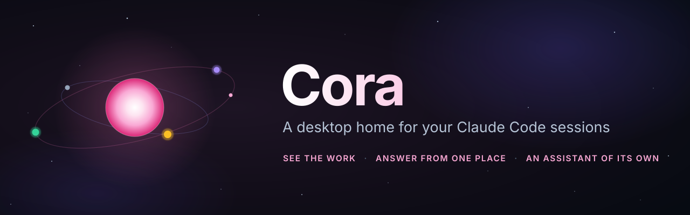

  
  
  
  

  <b>Every Claude Code session on your PC, live, in one place.</b> 
  See what each one is doing, answer its questions without hunting for the terminal, keep its terminal alive through
  restarts, and let an assistant of your own keep an eye on all of it.

  <a href="https://github.com/bleichroeder/cora/releases/latest"><b>Download for Windows</b></a>
  &nbsp;·&nbsp;
  <a href="docs/guide/getting-started.md">Get started</a>
  &nbsp;·&nbsp;
  <a href="docs/guide/">The guide</a>
  &nbsp;·&nbsp;
  <a href="docs/guide/security-and-privacy.md">Security and privacy</a>

  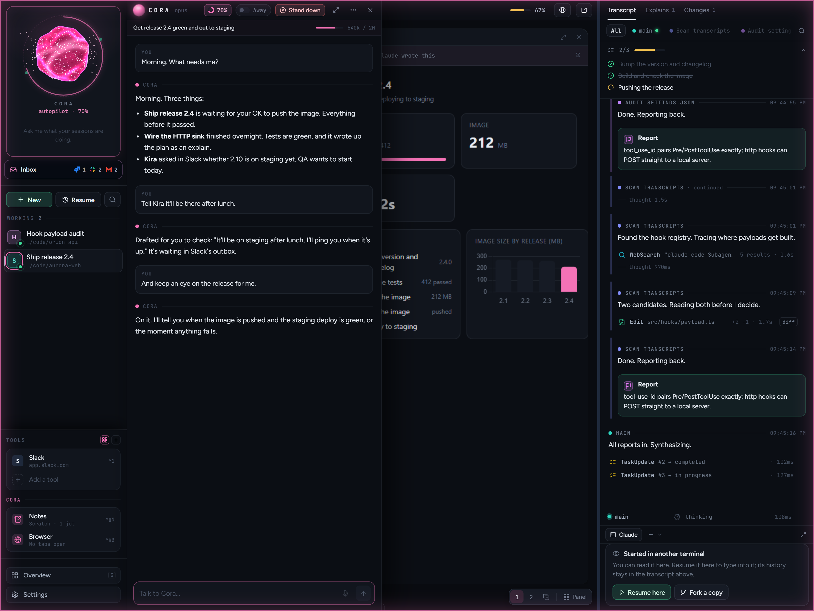

## Why Cora

Run a few Claude Code sessions at once and the terminals pile up. Which one is waiting for you? Which one finished?
What did that one change? Cora answers at a glance. It shows every session on your PC, whether you started it in Cora
or in any terminal, and what each is doing right now. It comes with an assistant that watches all of it for you.
Nothing changes about how Claude Code works: Cora uses its hooks and transcripts, and runs alongside the Claude Code you
already have.

## Cora, your assistant

<table>
  <tr>
    <td width="30%" valign="top">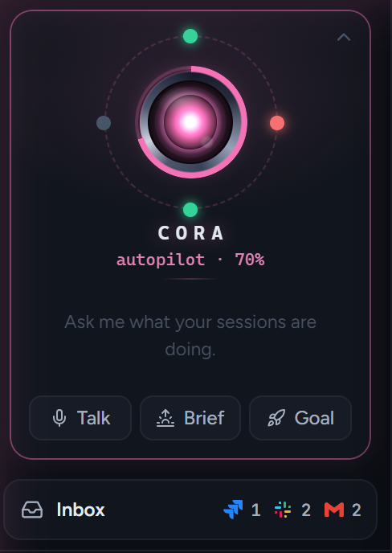</td>
    <td valign="top">
      Cora is a Claude Code session of its own that sits at the top of the nav and keeps an eye on everything:
      your sessions, pipelines, tickets, Slack and email.
      <ul>
        <li><b>Ask it anything.</b> "What needs me?", "Did the tests pass on the release?", "What did the sink session change?" It reads your sessions and answers.</li>
        <li><b>Briefs.</b> Back after a while? It tells you what happened and what's waiting for you.</li>
        <li><b>Goals.</b> Give it something to get done ("get release 2.4 green and out to staging") and it starts and steers sessions until it's done, within a token budget you set.</li>
        <li><b>It asks first.</b> Starting a session, messaging someone or ending one waits for your OK, unless you've given it rules to work by. Hard limits it never crosses, whatever the rules.</li>
        <li><b>Talk to it.</b> Type, hold a key, or just say "Hey Cora".</li>
      </ul>
    </td>
  </tr>
</table>

## Watch them work

  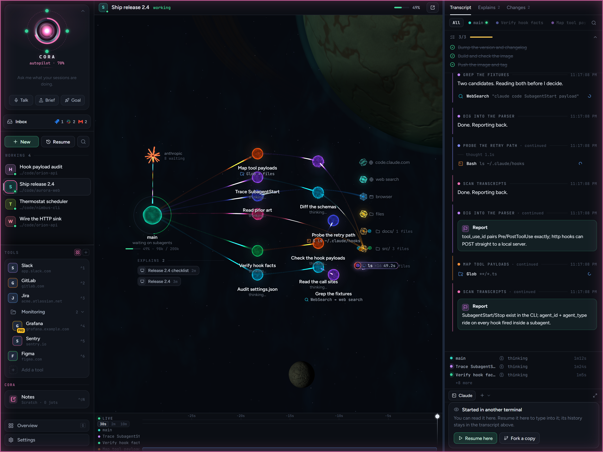

Every session is a small star system, drawn live from its hooks and transcript. The main agent sits at the centre,
and each subagent it starts (and each helper those start) gets its own orbit, labelled with what it's doing right now.
Tool calls fly as sparks to what they touch: files and folders, the web, the shell, a browser. The model burns at the
edge with a count of the agents waiting on it, and a timeline underneath lets you scrub back through every agent's
steps. Zoom out and every session on your PC is a star in one galaxy.

## Your tools, beside your sessions

  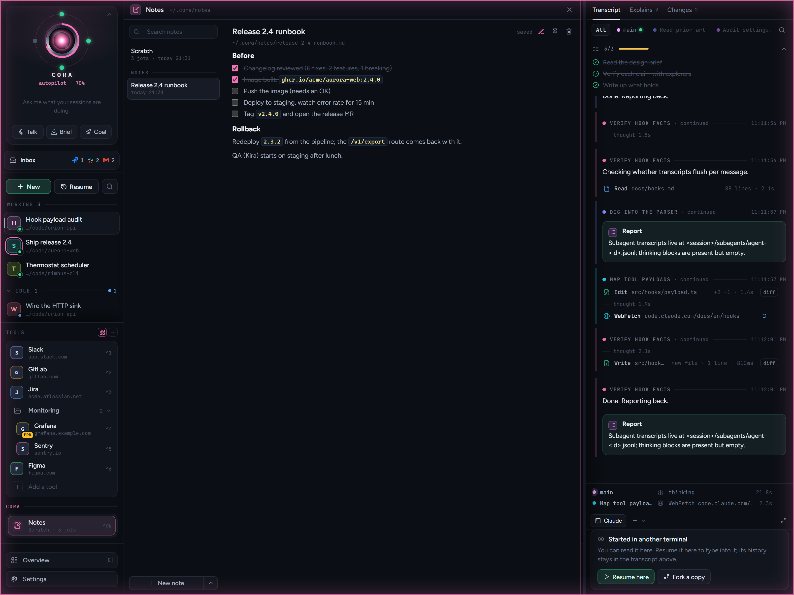

Slack, GitLab, Jira, Grafana, anything with a web page: pin them in the nav, group them in folders, tag them PRD or
DEV, and open them in a drawer next to the session you're in, signed in. Cora's own **Notes** live there too: a
scratchpad and runbooks your sessions can add to (and only add to). 1Password fills your logins right at the field.

## Everything else

<table>
  <tr>
    <td width="50%" valign="top">
      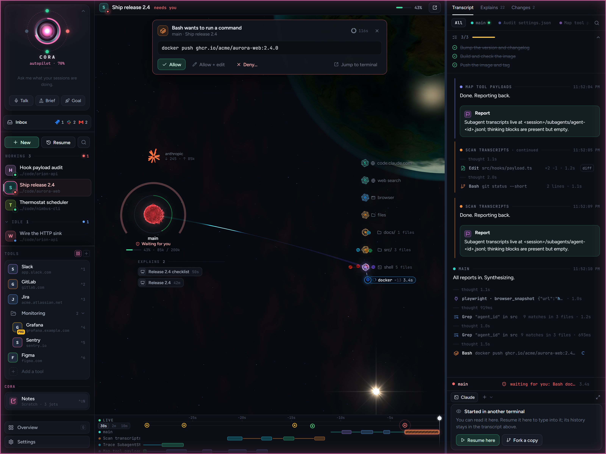
      <h3>Answer from one place</h3>
      Permission prompts and questions from any session land in Cora: Allow, Allow with changes, or Deny with a reason.
      Away from your desk? Answer from your phone through Cora's Slack bot.
    </td>
    <td width="50%" valign="top">
      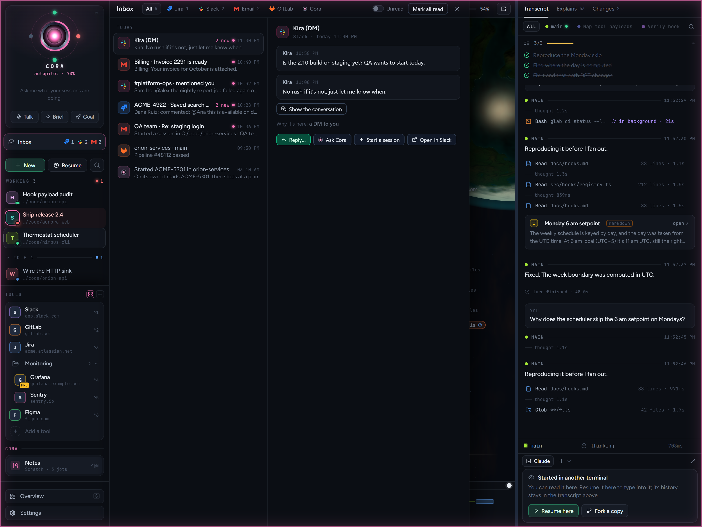
      <h3>One Inbox for your work</h3>
      Slack DMs and mentions, Jira changes, email you're watching for and failed pipelines, in one list. Reply, ask Cora
      about one, or start a session from it in a click.
    </td>
  </tr>
  <tr>
    <td width="50%" valign="top">
      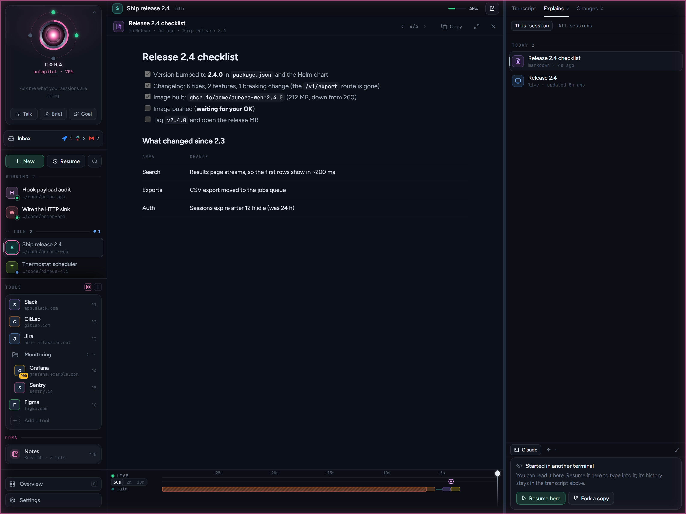
      <h3>Explains, not walls of text</h3>
      Ask for a plan, a comparison or a report and Claude writes it as a proper document beside the terminal, kept
      with the session to come back to.
    </td>
    <td width="50%" valign="top">
      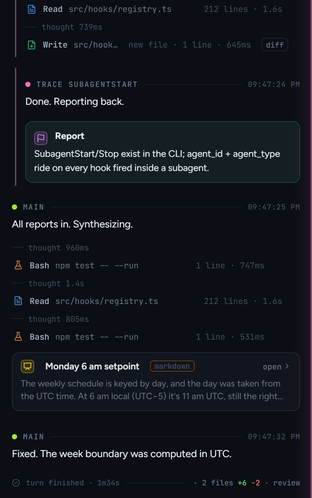
      <h3>A transcript you can read</h3>
      Each agent's steps, the files it changed (as diffs), the reports subagents hand back and Claude's task list,
      live, with a timeline to scrub back through.
    </td>
  </tr>
  <tr>
    <td width="50%" valign="top">
      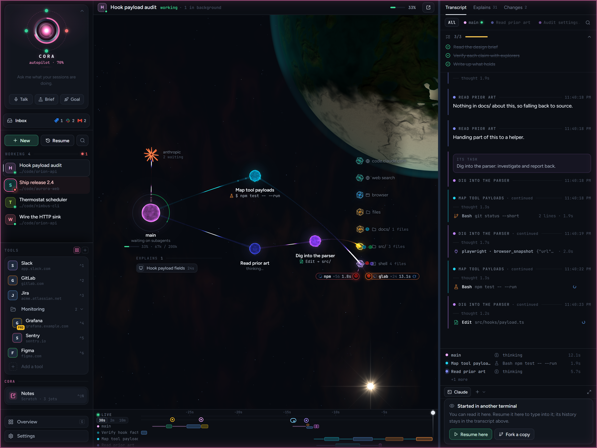
      <h3>See the work</h3>
      Each session as a small star system: its agents, and the files, web and shell they're using, as it happens.
    </td>
    <td width="50%" valign="top">
      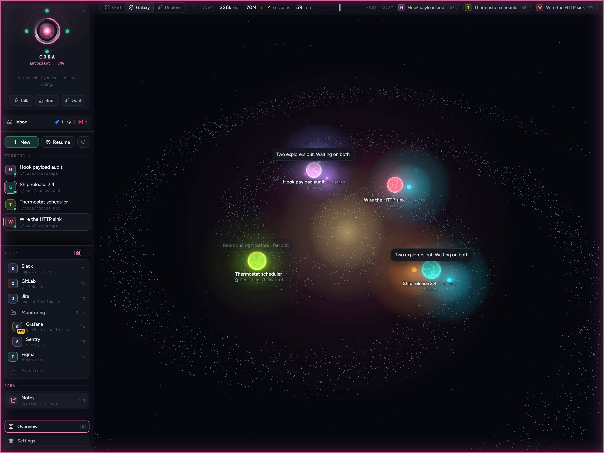
      <h3>Every session at once</h3>
      All your sessions together, grouped by folder, with what each is saying, what needs you and today's usage.
    </td>
  </tr>
</table>

### And more

- **Terminals that don't die.** Sessions started in Cora keep running when Cora restarts or updates, with shell tabs
  beside them.
- **Voice.** Hold a key to talk to a session, say "Hey Cora" to talk to the assistant, and hear short summaries read
  aloud.
- **A browser that knows your work.** Tabs per session, with your Chrome bookmarks and history in the address bar.
- **Your integrations.** Jira, Slack, Gmail, GitLab pipelines and Kubernetes deploys, each optional, each set up in a
  guided checklist.

## Get started

You need **Windows 10 or 11** and **[Claude Code](https://claude.com/claude-code)** (the Windows install, not WSL).

1. **[Download the latest `Cora-Setup-<version>.exe`](https://github.com/bleichroeder/cora/releases/latest)** and run it. It
   installs for you alone (no admin). The installer isn't code-signed yet, so Windows may warn you: choose **More info**,
   then **Run anyway**.
2. **Follow Setup.** Cora checks the two things it needs (Claude Code, and Cora's hooks in its settings) and lists the
   optional features, each with what it needs. Most install in a click.
3. **Work as usual.** Start sessions in Cora or in any terminal; they all show up.

  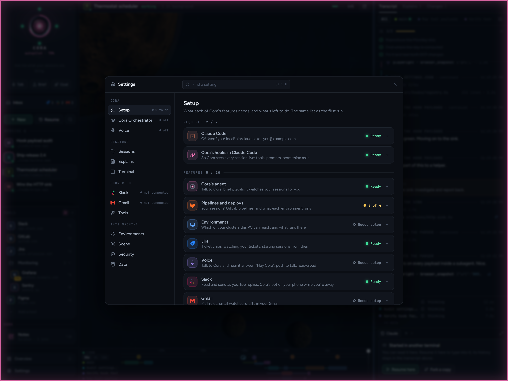

Cora updates itself. The full walk-through is in [Getting started](docs/guide/getting-started.md).

## Private by design

- **It all stays on your PC.** Cora listens only on `127.0.0.1` and keeps its data in `%USERPROFILE%\.cora`. There's
  no account, no cloud and no telemetry.
- **Secrets stay sealed.** Sign-ins are encrypted for your Windows user, and 1Password passwords are never stored at
  all: they go from 1Password straight into the page.
- **Sessions can't act as you.** They reach Cora through their own key, can't approve their own prompts, and can't
  send messages as you without your OK.
- **Other people's words are data.** Text from Slack, email and Jira is never treated as instructions.

The details are in [Security and privacy](docs/guide/security-and-privacy.md); to report a problem, see
[SECURITY.md](SECURITY.md).

## The guide

| | |
|---|---|
| [Getting started](docs/guide/getting-started.md) | Installing, Setup, updates, your first session |
| [Sessions](docs/guide/sessions.md) | Starting, resuming and finding sessions; the terminal and composer; permission prompts |
| [Seeing the work](docs/guide/seeing-the-work.md) | The scene, transcript, timeline, explains, changes and overview |
| [Cora, the assistant](docs/guide/cora.md) | Briefs, approvals, goals, away mode and its rules |
| [Voice](docs/guide/voice.md) | Push to talk, "Hey Cora", reading aloud |
| [Integrations](docs/guide/integrations.md) | Jira, Slack, Gmail, GitLab, deploys, the Inbox, notes, the browser, 1Password |
| [Security and privacy](docs/guide/security-and-privacy.md) | What stays on your PC, how secrets are kept, what sessions can reach |
| [Reference](docs/guide/reference.md) | Shortcuts, settings, the command line, files, troubleshooting |

## FAQ

**Is Cora made by Anthropic?** No. Cora is an independent open-source project built on top of Claude Code. It isn't
affiliated with or endorsed by Anthropic.

**Does it cost anything?** Cora is free. Your sessions use your own Claude Code plan as usual, and so does Cora's
assistant, which is a Claude Code session of its own (it's optional).

**Does it change how Claude Code works?** No. Cora adds hooks to Claude Code's settings so it hears what sessions do
(backed up first, and your own hooks are left alone). Sessions run exactly as they would in a terminal.

**macOS or Linux?** Not yet. Cora is Windows-only for now.

## Building from source

Cora is TypeScript throughout: an Electron app, a Fastify server, and a React and three.js dashboard. See
[Development](docs/development.md) for the layout, running from source, the simulator, tests and packaging, and
[CONTRIBUTING.md](CONTRIBUTING.md) to help out.

## License

[MIT](LICENSE). Claude and Claude Code are trademarks of Anthropic.
